# DIAGRAMA ENTIDAD-RELACIÓN (ER) - MEDICORE EMR

## Sistema de Expediente Médico Electrónico y Gestión Hospitalaria (Versión en Español 2.0)

Este documento contiene el modelo conceptual, lógico y relacional completo del sistema **MediCore EMR** traducido y estandarizado al idioma español, integrando las nuevas tablas clínicas solicitadas:
* **`epicrisis`** (Informe de alta y resumen de egreso clínico hospitalario / ambulatorio).
* **`tratamientos`** y **`tratamiento_medicamentos`** (Planes terapéuticos, objetivos y esquemas).
* **`medicamentos`** (Catálogo maestro e inventario farmacéutico).

---

## 1. Diagrama Entidad-Relación (Mermaid ERD)

```mermaid
erDiagram
    %% GESTIÓN Y ACCESOS
    roles ||--o{ usuarios : "asigna perfil a"
    clinicas ||--o{ usuarios : "emplea a"
    clinicas ||--o{ pacientes : "atiende a"
    clinicas ||--o{ citas_medicas : "agenda en"
    clinicas ||--o{ recetas_medicas : "emite en"
    clinicas ||--o{ epicrisis : "registra en"
    clinicas ||--o{ transacciones_financieras : "factura en"
    clinicas ||--o{ respaldos_base_datos : "almacena en"
    usuarios ||--o| preferencias_usuario : "configura"
    usuarios ||--o{ bitacora_auditoria : "genera evento en"

    %% DEPARTAMENTOS Y SERVICIOS
    departamentos ||--o{ servicios : "clasifica"
    servicios ||--o{ citas_medicas : "ofrece en"

    %% PACIENTE Y EXPEDIENTE
    pacientes ||--o{ contactos_emergencia : "tiene contacto"
    pacientes ||--o{ alergias_paciente : "padece alergia"
    pacientes ||--o{ citas_medicas : "solicita cita"
    pacientes ||--o{ signos_vitales : "se le miden signos"
    pacientes ||--o{ consultas_soap : "recibe consulta"
    pacientes ||--o{ tratamientos : "sigue tratamiento"
    pacientes ||--o{ recetas_medicas : "recibe receta"
    pacientes ||--o{ epicrisis : "se le elabora informe de"
    pacientes ||--o{ archivos_diagnostico : "posee estudio"
    pacientes ||--o{ odontologia_cartillas : "posee cartilla dental"
    pacientes ||--o{ registros_crecimiento_pediatrico : "se le registra curva"
    pacientes ||--o{ transacciones_financieras : "paga servicio"

    %% ATENCIÓN CLÍNICA Y DIAGNÓSTICOS
    usuarios ||--o{ citas_medicas : "atiende cita"
    citas_medicas ||--o| consultas_soap : "origina consulta"
    signos_vitales ||--o| consultas_soap : "se asocia a"
    usuarios ||--o{ consultas_soap : "atiende como medico"
    consultas_soap ||--o{ diagnosticos_consulta : "registra diagnostico"
    catalogo_cie10 ||--o{ diagnosticos_consulta : "codifica con CIE-10"

    %% FARMACOLOGÍA, TRATAMIENTOS Y MEDICAMENTOS
    usuarios ||--o{ tratamientos : "prescribe tratamiento"
    consultas_soap ||--o{ tratamientos : "deriva en tratamiento"
    catalogo_cie10 ||--o{ tratamientos : "se enfoca en patologia"
    tratamientos ||--o{ tratamiento_medicamentos : "incluye medicamento"
    medicamentos ||--o{ tratamiento_medicamentos : "se administra en dosis"

    %% RECETAS MÉDICAS
    consultas_soap ||--o{ recetas_medicas : "genera receta"
    tratamientos ||--o{ recetas_medicas : "materializa prescripcion"
    usuarios ||--o{ recetas_medicas : "firma receta"
    recetas_medicas ||--o{ detalle_receta : "detalla farmacos"
    medicamentos ||--o{ detalle_receta : "se dispensa en"

    %% EPICRISIS (INFORME DETALLADO DE ALTA / EGRESO)
    usuarios ||--o{ epicrisis : "elabora y firma alta"
    consultas_soap ||--o| epicrisis : "concluye episodio de"
    tratamientos ||--o| epicrisis : "resume respuesta al"
    catalogo_cie10 ||--o{ epicrisis : "diagnostico de ingreso"
    catalogo_cie10 ||--o{ epicrisis : "diagnostico de egreso"

    %% ODONTOLOGÍA Y PEDIATRÍA
    usuarios ||--o{ odontologia_cartillas : "elabora odontograma"
    odontologia_cartillas ||--o{ odontologia_hallazgos : "registra piezas dentales"
    usuarios ||--o{ registros_crecimiento_pediatrico : "evalua curva OMS"
    usuarios ||--o{ archivos_diagnostico : "sube estudio"
    consultas_soap ||--o{ archivos_diagnostico : "anexa estudio"

    %% FINANZAS
    citas_medicas ||--o| transacciones_financieras : "genera cobro de"

    %% DEFINICIÓN DE ATRIBUTOS CLAVE POR ENTIDAD

    roles {
        int id PK
        string nombre UK
        string descripcion
    }

    clinicas {
        int id PK
        string nombre
        string direccion
        string telefono
        string correo
        string identificacion_fiscal
    }

    usuarios {
        int id PK
        int clinica_id FK
        int rol_id FK
        string codigo_profesional UK
        string nombre_completo
        string correo UK
        string especialidad
        string cedula_profesional
    }

    pacientes {
        int id PK
        int clinica_id FK
        string codigo_paciente UK
        string numero_identidad UK
        string nombres
        string apellidos
        date fecha_nacimiento
        string genero
        string tipo_sangre
        boolean alerta_critica
    }

    contactos_emergencia {
        int id PK
        int paciente_id FK
        string nombre_completo
        string parentesco
        string telefono
    }

    alergias_paciente {
        int id PK
        int paciente_id FK
        string alergeno
        string reaccion
        string severidad
    }

    citas_medicas {
        int id PK
        int clinica_id FK
        int paciente_id FK
        int medico_id FK
        int servicio_id FK
        date fecha_cita
        time hora_cita
        string estado
    }

    signos_vitales {
        int id PK
        int paciente_id FK
        int registrado_por_usuario_id FK
        int presion_sistolica
        int presion_diastolica
        int frecuencia_cardiaca
        decimal temperatura_celsius
        decimal peso_kg
        decimal altura_cm
        decimal imc
        int saturacion_oxigeno_pct
    }

    consultas_soap {
        int id PK
        int cita_id FK
        int paciente_id FK
        int medico_id FK
        int signos_vitales_id FK
        datetime fecha_consulta
        string subjetivo
        string objetivo
        string evaluacion
        string plan
        boolean esta_firmada
    }

    catalogo_cie10 {
        int id PK
        string codigo UK
        string descripcion
        string capitulo
    }

    diagnosticos_consulta {
        int id PK
        int consulta_id FK
        int cie10_id FK
        string tipo_diagnostico
    }

    medicamentos {
        int id PK
        string codigo_nacional UK
        string nombre_comercial
        string nombre_generico
        string forma_farmaceutica
        string concentracion
        string via_administracion
        string presentacion
        string laboratorio_fabricante
        string codigo_atc
        boolean requiere_receta
        int stock_actual
        decimal precio_unitario
    }

    tratamientos {
        int id PK
        int paciente_id FK
        int medico_id FK
        int consulta_id FK
        int diagnostico_id FK
        string titulo_tratamiento
        string tipo_tratamiento
        string descripcion
        string objetivo_terapeutico
        date fecha_inicio
        date fecha_fin_estimada
        string estado
    }

    tratamiento_medicamentos {
        int id PK
        int tratamiento_id FK
        int medicamento_id FK
        string dosis
        string frecuencia
        string duracion
        string via_administracion
        int cantidad_total_prescrita
    }

    recetas_medicas {
        int id PK
        int consulta_id FK
        int tratamiento_id FK
        int paciente_id FK
        int medico_id FK
        int clinica_id FK
        string codigo_receta UK
        date fecha_emision
        string estado
    }

    detalle_receta {
        int id PK
        int receta_id FK
        int medicamento_id FK
        string nombre_medicamento_texto
        string dosis
        string frecuencia
        string duracion
        int cantidad_unidades
    }

    epicrisis {
        int id PK
        string codigo_epicrisis UK
        int paciente_id FK
        int medico_responsable_id FK
        int clinica_id FK
        int consulta_id FK
        int tratamiento_id FK
        datetime fecha_ingreso
        datetime fecha_egreso
        int dias_estancia
        string tipo_atencion
        string motivo_ingreso
        string resumen_historia_clinica
        int diagnostico_ingreso_id FK
        int diagnostico_egreso_id FK
        string resumen_evolucion
        string procedimientos_quirurgicos_realizados
        string tratamiento_recibido
        string estado_al_egreso
        string pronostico
        string plan_manejo_ambulatorio
        string medicacion_al_alta
    }

    archivos_diagnostico {
        int id PK
        int paciente_id FK
        int subido_por_usuario_id FK
        int consulta_id FK
        string nombre_archivo
        string categoria
        string archivo_url
    }

    odontologia_cartillas {
        int id PK
        int paciente_id FK
        int odontologo_id FK
        date fecha_cartilla
    }

    odontologia_hallazgos {
        int id PK
        int cartilla_id FK
        int numero_diente
        string superficies
        string condicion
        string estado
    }

    registros_crecimiento_pediatrico {
        int id PK
        int paciente_id FK
        int registrado_por_usuario_id FK
        date fecha_medicion
        decimal edad_meses
        decimal peso_kg
        decimal talla_cm
        decimal perimetro_cefalico_cm
    }

    transacciones_financieras {
        int id PK
        int clinica_id FK
        int paciente_id FK
        int cita_id FK
        string numero_factura UK
        string concepto
        decimal monto
        string metodo_pago
        string estado
    }
```



---

## 2. Descripción de los Módulos y Nuevas Tablas

### A. Módulo Farmacéutico (`medicamentos`)
* **Propósito**: Administrar el catálogo de fármacos disponibles para prescripción e inventario en clínicas y farmacias internas.
* **Campos clave**:
  - `nombre_generico` y `nombre_comercial`: Permite recetar tanto por principio activo como por marca.
  - `forma_farmaceutica` y `concentracion`: Tableta, cápsula, suspensión, inyectable (ej. 500mg, 10mg/ml).
  - `via_administracion`: Oral, Intravenosa, Tópica, Inhalatoria, etc.
  - `codigo_atc`: Clasificación Anatómica, Terapéutica y Química reconocida internacionalmente por la OMS.
  - `stock_actual` y `precio_unitario`: Control básico de farmacia y dispensación.

### B. Módulo de Tratamientos Médicos (`tratamientos` y `tratamiento_medicamentos`)
* **Propósito**: Gestionar esquemas terapéuticos integrales (farmacológicos, quirúrgicos, de rehabilitación, odontológicos, etc.) con seguimiento cronológico y objetivos médicos claros.
* **Relaciones**:
  - Un **Tratamiento** pertenece a un **Paciente**, es formulado por un **Médico**, puede derivarse de una **Consulta SOAP** y apuntar a un **Diagnóstico CIE-10**.
  - La tabla intermedia `tratamiento_medicamentos` establece la relación N:M entre `tratamientos` y `medicamentos`, definiendo la dosis, frecuencia, duración y cantidad exacta.

### C. Módulo de Epicrisis Hospitalaria / Cierre Clínico (`epicrisis`)
* **Definición Médica**: La **epicrisis** es el informe técnico médico oficial emitido al momento del alta hospitalaria o conclusión de un proceso de atención médica complejo. Resume de manera cronológica y exhaustiva:
  1. **Motivo de internamiento o consulta.**
  2. **Diagnósticos:** Tanto el diagnóstico presuntivo al ingreso como el diagnóstico definitivo al egreso (vinculados al catálogo `catalogo_cie10`).
  3. **Resumen de evolución intrahospitalaria:** Comportamiento clínico del paciente durante su estadía (`dias_estancia` calculado automáticamente).
  4. **Procedimientos y cirugías realizadas:** Intervenciones quirúrgicas, biopsias, drenajes o endoscopias.
  5. **Tratamiento recibido y complicaciones:** Fármacos intrahospitalarios, transfusiones y eventos adversos.
  6. **Estado de salida y pronóstico:** Curado, Mejorado, Estable, Secuelas, Traslado, Defunción.
  7. **Plan de manejo ambulatorio:** Dieta, reposo, medicamentos pautados para el hogar, citas de control y signos de alarma para reingreso inmediato por urgencias.

---

## 3. Matriz de Cardinalidades y Relaciones Relacionales (3FN)

| Tabla Origen (1) | Relación | Tabla Destino (N) | Clave Foránea (FK) | Regla On Delete / On Update |
| :--- | :--- | :--- | :--- | :--- |
| `clinicas` | 1 : N | `usuarios` | `usuarios.clinica_id` | RESTRICT / CASCADE |
| `roles` | 1 : N | `usuarios` | `usuarios.rol_id` | RESTRICT / CASCADE |
| `departamentos` | 1 : N | `servicios` | `servicios.departamento_id` | RESTRICT / CASCADE |
| `clinicas` | 1 : N | `pacientes` | `pacientes.clinica_id` | RESTRICT / CASCADE |
| `pacientes` | 1 : N | `contactos_emergencia` | `contactos_emergencia.paciente_id` | CASCADE / CASCADE |
| `pacientes` | 1 : N | `alergias_paciente` | `alergias_paciente.paciente_id` | CASCADE / CASCADE |
| `pacientes` | 1 : N | `citas_medicas` | `citas_medicas.paciente_id` | RESTRICT / CASCADE |
| `usuarios` (Médico) | 1 : N | `citas_medicas` | `citas_medicas.medico_id` | RESTRICT / CASCADE |
| `pacientes` | 1 : N | `signos_vitales` | `signos_vitales.paciente_id` | CASCADE / CASCADE |
| `pacientes` | 1 : N | `consultas_soap` | `consultas_soap.paciente_id` | RESTRICT / CASCADE |
| `citas_medicas` | 1 : 1 / Opc | `consultas_soap` | `consultas_soap.cita_id` | SET NULL / CASCADE |
| `signos_vitales` | 1 : 1 / Opc | `consultas_soap` | `consultas_soap.signos_vitales_id` | SET NULL / CASCADE |
| `consultas_soap` | 1 : N | `diagnosticos_consulta`| `diagnosticos_consulta.consulta_id` | CASCADE / CASCADE |
| `catalogo_cie10` | 1 : N | `diagnosticos_consulta`| `diagnosticos_consulta.cie10_id` | RESTRICT / CASCADE |
| `pacientes` | 1 : N | `tratamientos` | `tratamientos.paciente_id` | RESTRICT / CASCADE |
| `usuarios` (Médico) | 1 : N | `tratamientos` | `tratamientos.medico_id` | RESTRICT / CASCADE |
| `tratamientos` | 1 : N | `tratamiento_medicamentos` | `tratamiento_medicamentos.tratamiento_id` | CASCADE / CASCADE |
| `medicamentos` | 1 : N | `tratamiento_medicamentos` | `tratamiento_medicamentos.medicamento_id` | RESTRICT / CASCADE |
| `pacientes` | 1 : N | `recetas_medicas` | `recetas_medicas.paciente_id` | RESTRICT / CASCADE |
| `recetas_medicas` | 1 : N | `detalle_receta` | `detalle_receta.receta_id` | CASCADE / CASCADE |
| `medicamentos` | 1 : N / Opc | `detalle_receta` | `detalle_receta.medicamento_id` | SET NULL / CASCADE |
| `pacientes` | 1 : N | `epicrisis` | `epicrisis.paciente_id` | RESTRICT / CASCADE |
| `usuarios` (Médico) | 1 : N | `epicrisis` | `epicrisis.medico_responsable_id` | RESTRICT / CASCADE |
| `catalogo_cie10` | 1 : N | `epicrisis` (Ingreso) | `epicrisis.diagnostico_ingreso_id` | RESTRICT / CASCADE |
| `catalogo_cie10` | 1 : N | `epicrisis` (Egreso) | `epicrisis.diagnostico_egreso_id` | RESTRICT / CASCADE |
| `pacientes` | 1 : N | `odontologia_cartillas`| `odontologia_cartillas.paciente_id` | CASCADE / CASCADE |
| `odontologia_cartillas`| 1 : N | `odontologia_hallazgos`| `odontologia_hallazgos.cartilla_id` | CASCADE / CASCADE |
| `pacientes` | 1 : N | `registros_crecimiento_pediatrico`| `registros_crecimiento_pediatrico.paciente_id` | CASCADE / CASCADE |
| `pacientes` | 1 : N | `transacciones_financieras`| `transacciones_financieras.paciente_id` | RESTRICT / CASCADE |

---

## 4. Instrucciones para Carga y Prueba en MySQL / MySQL Workbench

1. Abre **MySQL Workbench**, DBeaver, phpMyAdmin o la consola MySQL (`mysql -u root -p`).
2. Abre o ejecuta el archivo:
   [medicore_schema.sql](file:///c:/MediCare/medicore_emr/database/medicore_schema.sql) o [medicore_emr_espanol.sql](file:///c:/MediCare/medicore_emr/database/medicore_emr_espanol.sql).
3. El script creará la base de datos `medicore_emr_db`, creará las 27 tablas en orden de dependencias foráneas, creará las 4 vistas analíticas y poblará los datos de prueba (seeds) en español.
4. Para consultar las vistas:
```sql
USE `medicore_emr_db`;

-- Ver citas médicas de hoy:
SELECT * FROM vw_resumen_citas_diarias;

-- Ver tratamientos activos y medicamentos prescritos:
SELECT * FROM vw_monitoreo_tratamientos_activos;

-- Ver las epicrisis clínicas elaboradas:
SELECT * FROM vw_resumen_epicrisis_clinica;
```
